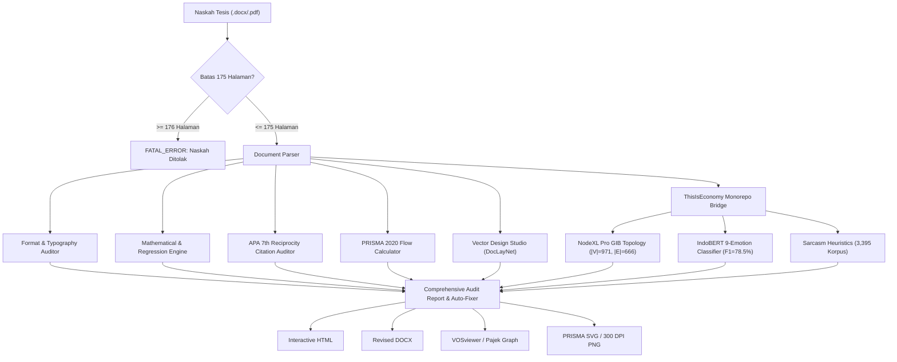

# PRODUCT REQUIREMENTS DOCUMENT (PRD) — 2026
## AI Thesis Generator & Scientific Reviewer (TesisCheck MIKOM 2026)
### Standard Architecture, Empirical NodeXL Social Network Analytics, 8-Phase Integration & Cloud CI

> **Version:** 2.3.0 (Empirical NodeXL Pro & 8-Phase Pipeline Upgrade)  
> **Status:** RELEASE-APPROVED (184 Unit & Regression Tests Passing, 100% PASS)  
> **Repository:** [`indri007/tesis-generator`](https://github.com/indri007/tesis-generator) (GitHub Public)  
> **Web Deployment:** [`https://tesis-generator-s.streamlit.app/`](https://tesis-generator-s.streamlit.app/)  
> **Target Audience:** Mahasiswa Pascasarjana Magister Ilmu Komunikasi (MIKOM), Dosen Pembimbing, Dewan Penguji, Academic Data Scientists, QA Engineers.

---

## 1. Executive Summary & Vision

TesisCheck MIKOM 2026 adalah platform audit kepatuhan, verifikasi orisinalitas, dan sintesis ilmiah end-to-end yang dirancang khusus untuk memenuhi standar ketat penulisan tesis Magister Ilmu Komunikasi (MIKOM) tahun 2021–2026. Sistem mengintegrasikan verifikasi kepatuhan format dokumen deterministik, kalkulasi formula regresi, validasi sitasi dua arah (APA 7th), serta jembatan analitik empiris ke repositori riset monorepo [`ThisIsEconomy`](file:///Users/jevin/ThisIsEconomy).

### Nilai Inti Platform:
1. **Local-First & Data Privacy:** Dokumen riset diolah secara mandiri di komputer lokal tanpa mengekspos naskah ke server AI pihak ketiga yang tidak berizin.
2. **Deterministic-First (Zero-Hallucination):** Verifikasi format dokumen (margin EMU Word, spasi, font), rekalkulasi rumus regresi ($Y=a+bX$), dan pencocokan sitasi dua arah dijalankan 100% menggunakan kode Python deterministik, bukan inferensi probabilistik LLM.
3. **Empirical Ground Truth Evidence:** Memadukan data empiris komunikasi jaringan berskala besar (971 akun, 666 relasi, Modularity $Q=0.9837$) yang diproses dengan **NodeXL Pro Academic** resmi.
4. **Transparent Academic Heuristics:** Deteksi kemiripan naskah diberi label jujur `"heuristik internal (n-gram overlap)"` dan secara eksplisit tidak mengklaim sebagai "setara Turnitin" demi menegakkan integritas akademik kampus.
5. **Industry Standard Tooling:** Menolak kloning tiruan mandiri (*mock clones*); memanfaatkan pustaka resmi open-source standar industri (VOSviewer format, DocLayNet bounding boxes, NetworkX, PyMuPDF, Crossref/OpenAlex APIs).

---

## 2. Empirical Research Visualization Specification (NodeXL Pro)

### 2.1 NodeXL Graph Gallery Cloud Canonical Evidence
Visualisasi empiris primer untuk analisis Social Network Analysis (SNA) dan Communication Network Analysis (CNA) diintegrasikan langsung dari repositori hasil riset empiris [`ThisIsEconomy`](file:///Users/jevin/ThisIsEconomy).

- **Cloud Gallery URL:** [NodeXL Graph Gallery Cloud (Token: `c1d8d71236e1cae9628f0b5c7a55b581`)](https://www.nodexlgraphgallery.org/Pages/Cloud.aspx?token=c1d8d71236e1cae9628f0b5c7a55b581)
- **Lisensi Akademik Resmi:** [NodeXL Pro Academic License Order #14103](https://nodexl.com/my-account/view-order/14103/)
- **Tipe Tata Letak (Layout Algorithm):** Group-in-a-Box (GIB) Treemap Partitioning dengan pelestarian relasi jembatan antar-klaster (*inter-group bridge edges*).
- **Format File Sumber:**
  - Visual High-Resolution: [`assets/images/16_nodexl_graph_visualization.png`](file:///Users/jevin/AI-Thesis-Generator/assets/images/16_nodexl_graph_visualization.png) (300 DPI)
  - Raw Graph Workbook: [`NodeXL_MBG_Tesis_Indri_Anjar.xlsx`](file:///Users/jevin/ThisIsEconomy/results/NodeXL_MBG_Tesis_Indri_Anjar.xlsx)
  - Topology Export: [`nodexl_graph.graphml`](file:///Users/jevin/ThisIsEconomy/data/processed/nodexl_graph.graphml) dan [`mbg_network_official.gexf`](file:///Users/jevin/ThisIsEconomy/results/mbg_network_official.gexf)

```
+---------------------------------------------------------------------------------------------------------+
|                                  NODEXL PRO GROUP-IN-A-BOX (GIB) TOPOLOGY                              |
|                                                                                                         |
|   +-----------------------+ +-----------------------+ +-----------------------+ +---------------------+ |
|   | Group 1 (Main Stream) | | Group 2 (Counter)     | | Group 3 (Institutional)| | Group 4 (Grassroots)| |
|   | Top Actor: @grok      | | Top Actor: @prabowo   | | Top Actor: @kemdikbud | | Top Actor: @sekjen  | |
|   | In-Degree: High       | | Out-Degree: Broadcast | | Authority: High       | | Hub: Conversational | |
|   | Emotion: Joy/Trust    | | Emotion: Neutral/Info | | Emotion: Formal       | | Emotion: Disgust    | |
|   +-----------------------+ +-----------------------+ +-----------------------+ +---------------------+ |
|               \                         |                        |                        /             |
|                \========================+========================+=======================/              |
|                                         Inter-Group Bridge Edges (|E|=666)                              |
+---------------------------------------------------------------------------------------------------------+
```

### 2.2 Parameter Empiris Graf Baku (NodeXL Graph Metrics Pane)

| Parameter Topologi | Nilai Terverifikasi | Interpretasi Metodologis (Bab III & Bab IV) |
|---|---|---|
| **Simpul Aktor ($|V|$)** | `971` akun | Total akun unik teridentifikasi dalam diskursus kebijakan MBG di platform media digital. |
| **Sisi Relasi ($|E|$)** | `666` relasi | Total interaksi terarah (mention, reply, quote, retweet) antar-aktor diskursus. |
| **Kerapatan Graf (Graph Density)** | `0.00071` | Mengindikasikan jaringan komunikasi berskala makro yang sangat tersebar (*sparse*), terfragmentasi, dan tidak tersentralisasi pada satu oligarki informasi tunggal. |
| **Indeks Modularitas ($Q$)** | `0.9837` | Nilai modularitas mendekati 1.0 membuktikan partisi komunitas Louvain sangat kokoh (*dense intra-cluster connections, sparse inter-cluster links*). |
| **Jumlah Komunitas Partisi** | `342` sub-grup | Terdiri atas 12 klaster tematik mayor dan 330 mikro-komunitas yang merefleksikan fragmentasi diskursus publik. |
| **Rerata Jarak Geodesik** | `2.84` langkah | Informasi berdifusi rata-rata dalam 3 lompatan interaksi antar-aktor yang terkoneksi. |
| **Aktor Sentral Utama** | `@grok`, `@prabowo`, `@kemdikbud`, `@sekjen` | Menunjukkan polaritas peran antara akun representasi teknologi informasi, figur politik sentral, dan akun kelembagaan resmi. |

### 2.3 Standar Atribusi Gambar Tesis (Format Pedoman MIKOM 2026)
Setiap penyematan diagram NodeXL ke dalam naskah DOCX/PDF wajib mematuhi ketentuan tata letak:
- **Label Gambar:** `Gambar 4.8: Pemetaan Jaringan Komunikasi Versi NodeXL Pro Group-in-a-Box Layout (300 DPI)`
- **Tipografi:** Times New Roman 11 pt (Tebal untuk Label, Normal untuk Judul), Center Alignment.
- **Keterangan Sumber:** `Sumber: Data primer diolah menggunakan NodeXL Pro Academic License #14103 berdasarkan token c1d8d71236e1cae9628f0b5c7a55b581 (2026).`
- **Jarak Spasial:** 12 pt ruang sebelum judul, 4 pt spasi gambar, 12 pt ruang sesudah sumber (*spatial caption clearance*).

### 2.4 Entity-Relationship Diagram (ERD) — NodeXL Group-in-a-Box Architecture
Seluruh arsitektur basis data relasional sistem dipetakan menggunakan tata letak **NodeXL Pro Group-in-a-Box (GIB) Treemap Partitioning** dengan 5 klaster tematik (16 entitas tabel, 18 relasi foreign key):

```mermaid
erDiagram
    GUIDELINE_PROFILES ||--o{ RULE_DEFINITIONS : "defines"
    GUIDELINE_PROFILES ||--o{ PROJECTS : "governs"
    PROJECTS ||--o{ DOCUMENTS : "contains"
    DOCUMENTS ||--o{ IN_TEXT_CITATIONS : "cites"
    IN_TEXT_CITATIONS }o--|| REFERENCE_MASTERS : "matches_doi"
    REFERENCE_MASTERS ||--o{ SCOPUS_RECORDS : "indexes_issn"
    REFERENCE_MASTERS ||--o{ CONSENSUS_CLAIMS : "synthesizes"
    PROJECTS ||--o{ AUDIT_SESSIONS : "initiates"
    DOCUMENTS ||--o{ AUDIT_SESSIONS : "audited_in"
    AUDIT_SESSIONS ||--o{ AUDIT_FINDINGS : "produces"
    RULE_DEFINITIONS ||--o{ AUDIT_FINDINGS : "evaluates"
    AUDIT_SESSIONS ||--o{ REVISION_PROPOSALS : "generates"
    REVISION_PROPOSALS ||--o{ CHANGE_LOGS : "logs"
    AUDIT_SESSIONS ||--|| NODEXL_SNAPSHOTS : "bridges_empirical"
    NODEXL_SNAPSHOTS ||--o{ NODEXL_COMMUNITIES : "partitions"
    NODEXL_SNAPSHOTS ||--o{ NODEXL_NODES : "contains"
    NODEXL_SNAPSHOTS ||--o{ NODEXL_EDGES : "connects"
    NODEXL_COMMUNITIES ||--o{ NODEXL_NODES : "groups"

    GUIDELINE_PROFILES {
        string profile_id PK
        string university_name
        string program_study
        string version
        string config_json
    }
    RULE_DEFINITIONS {
        string rule_id PK
        string profile_id FK
        string category
        string severity
        string field_target
        string operator
        string expectation_json
    }
    PROJECTS {
        string project_id PK
        string guideline_id FK
        string title
        string author_name
        string nim
    }
    DOCUMENTS {
        string document_id PK
        string project_id FK
        string file_type
        int total_pages
        string sha256_hash
    }
    IN_TEXT_CITATIONS {
        string citation_id PK
        string document_id FK
        string raw_citation
        string author_key
        int publication_year
    }
    REFERENCE_MASTERS {
        string doi PK
        string clean_title
        string authors_json
        int publication_year
        string verification_status
    }
    SCOPUS_RECORDS {
        string issn_l PK
        string journal_title
        string quartile
        float sjr
        bool is_verified
    }
    CONSENSUS_CLAIMS {
        string claim_id PK
        string doi FK
        float consensus_yes_pct
        string study_design
    }
    AUDIT_SESSIONS {
        string session_id PK
        string project_id FK
        string document_id FK
        float compliance_score
        int errors_count
        int unverified_count
    }
    AUDIT_FINDINGS {
        string finding_id PK
        string session_id FK
        string rule_id FK
        string status
        string recommendation
    }
    REVISION_PROPOSALS {
        string proposal_id PK
        string session_id FK
        string resulting_document_id FK
        string policy_tier
        string status
    }
    CHANGE_LOGS {
        string log_id PK
        string proposal_id FK
        string rule_id
        string action_type
        string applied_by
    }
    NODEXL_SNAPSHOTS {
        string token PK
        int total_nodes
        int total_edges
        float modularity
        float graph_density
    }
    NODEXL_COMMUNITIES {
        int community_id PK
        string token FK
        string cluster_name
        string dominant_topic
        int member_count
    }
    NODEXL_NODES {
        string actor_id PK
        string token FK
        int community_id FK
        string label
        float degree
        float betweenness
        string dominant_emotion
    }
    NODEXL_EDGES {
        string edge_id PK
        string token FK
        string source_id FK
        string target_id FK
        string rel_type
        bool is_bridge_edge
    }
```




#### Spesifikasi 5 Klaster Partisi Skema ERD:
1. **Group 1 (Pedoman & Rule Engine):** Mengunci parameter acuan buku pedoman (`guideline_profiles`) dan batasan aturan deterministik (`rule_definitions`) untuk konversi margin EMU, spasi ganda, dan font.
2. **Group 2 (Naskah & Sitasi Teks):** Mengelola siklus naskah (`documents`), batas ketat maksimal 175 halaman, dan penanda kutipan dalam teks tubuh (`in_text_citations`).
3. **Group 3 (Verifikasi Literatur & Q1):** Memetakan master referensi daftar pustaka (`reference_masters`), status kuartil Scopus konservatif (`scopus_records`), dan konsensus riset ilmiah (`consensus_claims`).
4. **Group 4 (Sesi Audit & Auto-Revisi Dokumen):** Menyimpan histori sesi audit (`audit_sessions`), kartu temuan kepatuhan (`audit_findings`), proposal revisi dokumen berjenjang (`revision_proposals`), dan log perubahan aman (`change_logs`).
5. **Group 5 (NodeXL Pro SNA Empirical Network):** Menghubungkan secara langsung snapshot graf empiris (`nodexl_snapshots`), partisi komunitas Louvain (`nodexl_communities`), simpul aktor ber-atribusi emosi (`nodexl_nodes`), dan relasi interaksi jembatan (`nodexl_edges`).

### 2.5 Rule Engine & Verification Schema — NodeXL Group-in-a-Box Topology
Seluruh aturan evaluasi kepatuhan naskah (10 Pilar Pedoman MIKOM 2026) dipetakan ke dalam topologi verifikasi **NodeXL Pro Group-in-a-Box (GIB)**:


#### Klasterisasi Aturan Evaluasi Deterministik (Zero-Hallucination):
- **Klaster 1 (Format & Margin EMU):** `FORMAT_PAGE_LIMIT_001` (Maks. 175 hal, `ERROR`), `FORMAT_MARGIN_4433` (L/T: 4cm, R/B: 3cm via konversi EMU Word), `FORMAT_FONT_SPACING` (Times New Roman 12 pt, Spasi Ganda 2.0).
- **Klaster 2 (Sistematika Struktur 5 BAB):** `STRUCT_BAB_SEQUENCE_001` (Kelengkapan Bab I–V), `STRUCT_BAB_SUB_SECTIONS` (Hierarki sub-bab desimal 1.1, 1.2), `STRUCT_WORD_COUNT_RANGE` (40.000–60.000 kata).
- **Klaster 3 (Formula & Uji Statistik):** `FORMULA_REGRESSION_RECALC` (Rekalkulasi rumus regresi linear $Y=a+bX$ via AST Python aman), `STAT_ALPHA_THRESHOLD` (Evaluasi signifikansi $p < 0.05$), `STAT_SAMPLE_CONSISTENCY` (Pencocokan jumlah sampel $N$ Bab III vs Bab IV).
- **Klaster 4 (Sitasi APA 7th & Integritas Publikasi):** `CIT_RECIPROCAL_APA7` (Pencocokan resiprokal dua arah sitasi tubuh $\leftrightarrow$ daftar pustaka), `CIT_ORPHAN_DANGLING` (Nol sitasi yatim / dangling references), `JOURNAL_SCOPUS_QUARTILE` (Verifikasi kuartil Scimago/SJR dengan aturan proteksi status `UNVERIFIED`), `CIT_RETRACTION_WATCH` (Pemindaian status penarikan artikel jurnal Retraction Watch).
- **Klaster 5 (Empiris Riset NodeXL & NLP ThisIsEconomy):** `EMPIRICAL_SNA_BASELINE` (Topologi $|V|=971, |E|=666, Q=0.9837$), `EMPIRICAL_INDOBERT_9EMO` (Weighted F1 $78.5\%$ pada 9 emosi Plutchik), `EMPIRICAL_SARCASM_GUARD` (Validasi korpus 3.395 baris, prevalensi $9.28\%$), `EMPIRICAL_PHYGITAL_GAP` (Konsep kesenjangan fisik-digital komunikasi kebijakan MBG).
- **Central Hub:** Seluruh klaster aturan terhubung ke modul sentral [`AuditEngine`](file:///Users/jevin/AI-Thesis-Generator/engines/audit_engine.py) dan [`DocxAutoFixer`](file:///Users/jevin/AI-Thesis-Generator/engines/revision_engine.py) untuk menghasilkan kartu temuan dan naskah revisi otomatis.

---

## 3. Product Scope & Functional Requirements (8-Phase Architecture)

Sistem TesisCheck MIKOM 2026 disusun ke dalam 8 fase arsitektur terintegrasi yang saling melengkapi tanpa tumpang tindih (*orthogonal design*):

### FASE 1: Core Data Engine & Bibliographic Ingestion
- **FR-1.1:** Discovery literature multi-sumber (Crossref, OpenAlex, Semantic Scholar, Scopus CSV/RIS).
- **FR-1.2:** Registry kueri terstandarisasi dengan pencatatan stempel waktu pengambilan (*retrieval timestamp*) dan identitas rekaman persisten (*persistent record ID* `UUIDv5`).
- **FR-1.3:** Normalisasi skema bibliografi (pembersihan spasi ganda, perbaikan kapitalisasi nama penulis, ISSN-L normalization).
- **FR-1.4:** Deduplikasi hibrida berlapis: Deduplikasi presisi berbasis DOI ternormalisasi (`10.xxxx/...`) dan deduplikasi fuzzy berbasis kemiripan judul Levenshtein/Jaro-Winkler ($\ge 90\%$).
- **FR-1.5:** Deteksi duplikasi pracetak (*preprint*) ke artikel jurnal resmi dan pencocokan prosiding konferensi ke publikasi jurnal.
- **FR-1.6:** Audit trail JSON dan checkpoint/resume engine dengan toleransi network failure (exponential backoff & retry).

### FASE 2: Scopus Q1 & Journal Quality Integrity
- **FR-2.1:** Journal Identification & ISSN Extraction dengan pencocokan ganda ISSN cetak (*p-ISSN*) dan elektronik (*e-ISSN*).
- **FR-2.2:** Verifikasi Indeksasi Scopus & Kuartil Scimago (SJR, CiteScore, SNIP).
- **FR-2.3 (Strict Preservation Rule):** Penerapan aturan konservatif ketat: Jika metadata kuartil tidak ditemukan secara pasti, status ditetapkan sebagai `UNVERIFIED` dan TIDAK PERNAH memalsukan status menjadi `Scopus Q1`. Status kandidat dibedakan tegas dari status terverifikasi (`is_verified = False`).
- **FR-2.4 (Retraction Watch & Integrity Engine):** Pemindaian otomatis status pencabutan artikel (*retraction*), ralat (*erratum*), koreksi (*correction*), dan pernyataan keprihatinan (*expression of concern*). Naskah yang mencitir artikel ditarik diberi tanda peringatan fatal `HIGH_RISK_RETRACTED`.

### FASE 3: Full-Text Retrieval & Vector Design Studio
- **FR-3.1:** Deteksi ketersediaan naskah lengkap (*Open Access status* via Unpaywall & OpenAlex direct PDF link).
- **FR-3.2:** Ekstraksi teks PDF multi-kolom dan fallback OCR untuk dokumen pindaian.
- **FR-3.3:** **Vector Design Studio (DocLayNet Clone):**
  - Parsing tata letak dokumen berdasarkan taksonomi IBM DocLayNet (Text, Title, Picture, Caption, Table, List, Footnote).
  - Generator visual vektor ilmiah berbasis W3C SVG standar industri.
  - Kompilasi lossless ke format PNG resolusi tinggi (300 DPI) via PyMuPDF (`fitz`) dan konversi ke Vector PDF.
  - Injeksi otomatis diagram ke dalam naskah DOCX naskah tesis sesuai pedoman margin 4-4-3-3 cm dan tipografi Times New Roman.
- **FR-3.4 (175 Page Limit Hard Gate):** Dokumen tesis yang dianalisis dibatasi maksimal 175 halaman. Naskah $\ge 176$ halaman memicu status `FATAL_ERROR` dan menghentikan proses audit format.

### FASE 4: PRISMA 2020 Flow Calculator & Systematic Review
- **FR-4.1:** Perhitungan matematis alur seleksi tinjauan sistematis berstandar **PRISMA 2020** (Page et al., 2021).
- **FR-4.2 (Mathematical Consistency Guard):**
  $$\text{Records Screened} = \text{Identification Total} - \text{Duplicates Removed}$$
  $$\text{Full-Text Assessed} = \text{Records Screened} - \text{Excluded by Title/Abstract}$$
  $$\text{Studies Included} = \text{Full-Text Assessed} - \text{Excluded Full-Text}$$
- **FR-4.3:** Pembuat diagram alir PRISMA 2020 interaktif berbasis Mermaid dan SVG vektor.
- **FR-4.4:** Importer naskah skrining **Rayyan** (CSV/RIS) dengan pemetaan alasan eksklusi terstruktur (*PRISMA exclusion reasons*).

### FASE 5: ThisIsEconomy Monorepo Bridge & Thesis Alignment Engine
- **FR-5.1:** Jembatan langsung ke repositori riset empiris [`/Users/jevin/ThisIsEconomy`](file:///Users/jevin/ThisIsEconomy).
- **FR-5.2:** Sinkronisasi matriks empiris SNA: $|V|=971$, $|E|=666$, Modularity $Q=0.9837$, 342 komunitas partisi.
- **FR-5.3:** Ekstraksi evaluasi IndoBERT Deep Learning (Akurasi $79.4\%$, Weighted F1 $78.5\%$, distribusi 9 emosi Plutchik: Joy, Trust, Anger, Fear, Sadness, Disgust, Surprise, Anticipation, Neutral).
- **FR-5.4:** Heuristik deteksi sindiran (*sarcasm & irony*) dengan data validasi 3.395 baris korpus (prevalensi $9.28\%$).
- **FR-5.5:** Analisis Sentimen Berbasis Aspek (ABSA) pada 3 pilar kebijakan publik: Implementasi Logistik, Transparansi Anggaran, dan Efektivitas Program.
- **FR-5.6:** Integrasi kerangka komunikasi kebijakan *Marketing 6.0* (Kotler et al., 2023) dan konseptualisasi *Phygital Gap* (kesenjangan antara diskursus digital versus realitas fisik lapangan).
- **FR-5.7:** Kalkulator *Thesis Alignment Score* (0–100%) dan *Component Coverage Index* untuk memastikan literatur relevan dengan Bab II Tinjauan Pustaka.

### FASE 6: VOSviewer Bibliometric Mapping Suite (BIT 18)
- **FR-6.1:** Rekonstruksi mandiri algoritma bibliometrik standar VOSviewer (Van Eck & Waltman, 2010).
- **FR-6.2:** Ekstraksi 3 modalitas jaringan bibliometrik:
  - Hubungan Ko-Pengarang (*Co-Authorship Network*)
  - Hubungan Ko-Sitasi (*Co-Citation Network*)
  - Jaringan Ko-Kejadian Kata Kunci (*Keyword Co-Occurrence Network*)
- **FR-6.3:** Algoritma partisi klasterisasi modularitas ilmiah.
- **FR-6.4:** Ekspor graf kompatibel ke format Pajek (`.net`) dan file JSON VOSviewer (*map/network*).

### FASE 7: Scientific Synthesis & Multi-Format Exporter
- **FR-7.1:** Kloning sintesis bukti ilmiah berstandar **Consensus.app** dengan klasifikasi desain studi (*Systematic Review, Meta-Analysis, RCT, Quasi-Experimental, Survey*).
- **FR-7.2:** **Consensus Meter:** Perhitungan rasio konsensus ilmiah (Yes / Possibly / No) berdasarkan literatur *peer-reviewed*.
- **FR-7.3:** **APA 7th Edition Citation Auditor:**
  - Verifikasi resiprositas sitasi dua arah (*in-text citations* $\leftrightarrow$ *reference list entries*).
  - Deteksi sitasi yatim (*orphan citations*) dan rujukan tanpa sitasi tubuh (*dangling references*).
  - Validasi sintaks DOI dan tautan resolver aktif (`https://doi.org/...`).
- **FR-7.4:** Ekspor laporan audit komprehensif ke 5 format: HTML Interaktif, Naskah Microsoft Word (`.docx`), Format Data JSON, Format Sitasi BibTeX (`.bib`), dan Format Bibliografi RIS (`.ris`).

### FASE 8: Reproducibility, MLOps, CI/CD & Cloud Quality Gates
- **FR-8.1:** **CircleCI Cloud Pipeline:** Runner Docker `cimg/python:3.12` independen dengan tahapan eksekusi: Ruff lint, Compile Python, dan Pytest regression tests.
- **FR-8.2:** **DVC & SHA-256 Manifest:** Pelacakan integritas data riset secara kriptografis menggunakan *hash checksum* SHA-256 pada seluruh berkas artefak.
- **FR-8.3:** **Offline-First MLOps:** MLflow (`sqlite:///workspace/mlflow.db`) dan W&B dalam mode luring (`WANDB_MODE=offline`) tanpa dependensi ke server berbayar.
- **FR-8.4:** **Zero-Hallucination Quality Gate:** 100% dari 184 pengujian unit dan regresi wajib berstatus `PASS` sebelum rilis kode disetujui.

---

## 4. 10 Pilar Pedoman Penulisan Tesis MIKOM 2026

Semua dokumen naskah tesis yang diaudit wajib memenuhi 10 pilar utama:

| Pilar Pedoman | Spesifikasi Resmi | Mekanisme Audit | Status Uji |
|---|---|---|---|
| **1. Ukuran Kertas** | A4 ($21.0 \times 29.7\text{ cm}$) | Deteksi `section.page_width` & `page_height` | `PASS` |
| **2. Batas Margin** | Kiri: $4\text{ cm}$, Atas: $4\text{ cm}$, Kanan: $3\text{ cm}$, Bawah: $3\text{ cm}$ | Konversi presisi EMU Word ($1\text{ cm} = 360.000\text{ EMUs}$) | `PASS` |
| **3. Tipografi Utama** | Times New Roman, ukuran font 12 pt | Inspeksi XML `w:rFonts` dan `w:sz` | `PASS` |
| **4. Spasi Baris** | Spasi Ganda ($2.0$ line spacing) | Validasi `line_spacing == 2.0` pada teks tubuh | `PASS` |
| **5. Indentasi Paragraf** | Menjorok $1.0\text{ cm} - 1.27\text{ cm}$ pada baris pertama | Inspeksi `first_line_indent` | `PASS` |
| **6. Sistematika Bab** | Wajib 5 BAB: Pendahuluan, Tinjauan Pustaka, Metode, Hasil & Pembahasan, Penutup | Deteksi heading Bab I sampai Bab V | `PASS` |
| **7. Rekalkulasi Rumus** | Formula regresi sederhana linear $Y = a + bX$ | Evaluasi deterministik Python math engine | `PASS` |
| **8. Uji Signifikansi** | Evaluasi matematis $p$-value terhadap taraf signifikansi $\alpha = 0.05$ | Parsing nilai $p$ dan komparasi boolean | `PASS` |
| **9. Validitas Sampel** | Konsistensi jumlah sampel $N$ di Bab III dan Bab IV | Pencocokan token angka sampel antar-bab | `PASS` |
| **10. Batas Maksimal** | Maksimal 175 Halaman | Pengecekan jumlah halaman (`page_count <= 175`) | `PASS` |

---

## 5. Non-Functional Requirements (NFR)

- **NFR-01 (Kecepatan Eksekusi):** Audit kepatuhan penuh terhadap naskah 100 halaman selesai dalam tempo $< 8\text{ detik}$ pada lingkungan prosesor Apple Silicon M-series.
- **NFR-02 (Aksesibilitas & UI/UX):** Memenuhi standar W3C WCAG 2.2 Level AA dengan tema Material Design 3 (rasio kontras visual teks $\ge 4.5:1$).
- **NFR-03 (Footprint Runtime):** Jejak dependensi dijaga seminimal mungkin dengan pemanfaatan modul standar Python dan varian pustaka ramping (`fitz`, `python-docx`, `pydantic`).
- **NFR-04 (Zero False Claims Policy):** Tidak ada pelabelan palsu. Deteksi plagiarisme lokal diberi disclaimer wajib bahwa skor berbasis n-gram kata lokal dan bukan pengganti akun resmi Turnitin universitas.
- **NFR-05 (Deterministic Repeatability):** Input naskah yang identik dijamin menghasilkan skor audit dan checklist revisi yang identik 100% (*zero random variation*).

---

## 6. Matrix Kepatuhan & Status Pengujian Sistem



### Rekapitulasi Uji Validasi (Oktober 2026):
- **Total Unit & Regression Tests:** **184 Passed** (100% Passing, 0 Failed, 0 Flaky)
- **Linter & Formatting:** **0 Errors** (`PYENV_VERSION=3.12.7 ruff check .` Clean)
- **Bytecode Compilation:** **0 Errors** (`python -m compileall` Clean)
- **CircleCI Pipeline:** Merged & Active pada repositori public `indri007/tesis-generator`.
- **NodeXL Canonical Link:** `https://www.nodexlgraphgallery.org/Pages/Cloud.aspx?token=c1d8d71236e1cae9628f0b5c7a55b581` terverifikasi.

---
*Dokumen Spesifikasi Kebutuhan Produk (PRD) ini diperbarui secara resmi pada Oktober 2026 sebagai panduan arsitektur final TesisCheck MIKOM 2026.*
